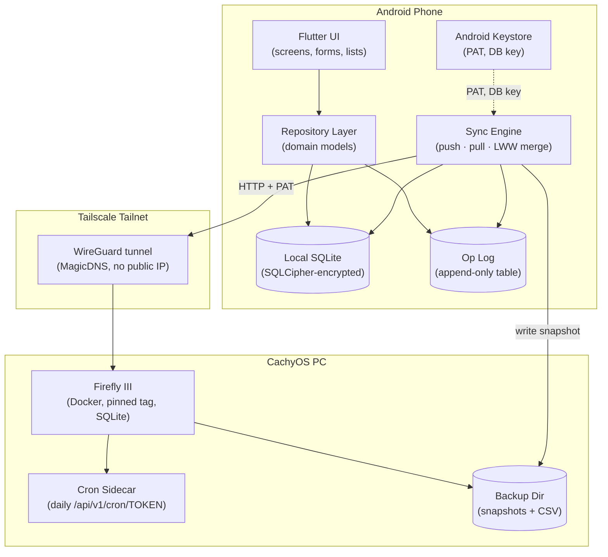

# Firefly III Mobile — Design Document

**Version:** 1.0
**Status:** Draft for review
**Date:** 2026-10-11
**Author:** Architecture session (opencode)

---

## 1. Overview & Goals

A **local-first Android expense tracker** that:

1. Provides **full CRUD parity with Firefly III** while 100 % offline (airplane mode, no PC, no internet).
2. **Synchronizes bidirectionally** with a self-hosted Firefly III instance running in Docker on the user's CachyOS PC whenever connectivity is available.
3. Costs **$0** to run — no cloud services, no paid tiers, no domain names, no always-on hardware.
4. Keeps a **manual-export backup** written to the PC on every successful sync.
5. Delegates **rules and recurrences** to the Firefly III server (execution is PC-only; definitions sync both ways).

### 1.1 Requirements Matrix

| # | Constraint / Requirement | Mechanism |
|---|---|---|
| R1 | Full CRUD offline | Local SQLite (SQLCipher) is the source of truth on the phone; UI reads/writes only the local DB. |
| R2 | Bidirectional sync | Op-log push (POST/PATCH) + full-paginate pull (GET) with local diff by `updated_at`. |
| R3 | Ordered, idempotent, exactly-once semantics | Op log keyed `(timestamp_ms, device_id, seq)`; replay earliest-first; `op_id` idempotency. |
| R4 | Conflict resolution | Field-level Last-Write-Wins (LWW) with deterministic tiebreak. |
| R5 | $0 / no domain / no always-on device | Tailscale free plan (WireGuard, MagicDNS) — no public IP, no port-forward, no cert. |
| R6 | Manual-export backup on every sync | SQLite single-file snapshot + CSV export copied to PC after each successful sync. |
| R7 | Rules/recurrences execute PC-only | Definitions sync both ways; phone renders read-only preview from local definitions; execution gated by server cron. |
| R8 | Phone loss recovery | Backup snapshots on PC allow full restore into a fresh phone install. |
| R9 | API stability | Firefly III Docker image **pinned** to exact tag (never `latest`). |

---

## 2. Architecture

### 2.1 Component Diagram



### 2.2 Component Responsibilities

| Component | Responsibility |
|---|---|
| **Flutter UI** | All screens (accounts, transactions, budgets, categories, tags, bills, piggy banks, rules, recurrences). Reads/writes only through the repository layer. Never calls network directly. |
| **Repository Layer** | Domain models, DAOs, business invariants. Every mutation also appends an op-log entry in the same SQLite transaction. |
| **Local SQLite** | Authoritative local store. Encrypted with SQLCipher; key in Android Keystore. |
| **Op Log** | Append-only journal of pending mutations. Cleared only after confirmed server acknowledgment. |
| **Sync Engine** | Orchestrates push (replay op-log) and pull (paginate + diff). Applies LWW merge. Writes backup snapshot after successful sync. |
| **Android Keystore** | Holds Firefly PAT and SQLCipher key. Never leaves secure hardware. |
| **Firefly III (Docker)** | Server of record. Runs on CachyOS PC. Pinned image tag. SQLite DB in a Docker volume. |
| **Cron Sidecar** | Hits `/api/v1/cron/<TOKEN>` daily at 03:00 server time — triggers recurrence generation and rule execution. |
| **Tailscale** | Free WireGuard mesh. Phone + CachyOS + Bazzite join one tailnet. No public exposure. |
| **Backup Dir** | On CachyOS: `~/firefly-backups/` receives `database.sqlite` copy + per-entity CSV exports after each successful sync. |

### 2.3 Data Flow (Happy Path)

1. User adds a transaction offline → UI writes to SQLite + appends `op_create` to op-log (single DB transaction).
2. Phone joins Wi-Fi / Tailscale → Sync Engine wakes.
3. **Push phase:** Sync Engine replays op-log entries in order, POSTs to Firefly, records `firefly_id` in local row, deletes op-log entry on 2xx.
4. **Pull phase:** Sync Engine paginates all entity lists, diffs each resource's `updated_at` against local, applies field-level LWW for any conflict, writes merged rows to SQLite.
5. **Backup phase:** Sync Engine copies `database.sqlite` + writes CSV exports to `~/firefly-backups/` on the PC (via SSH or a small local endpoint — see §8).
6. UI refreshes from local SQLite; pending badges clear.

---

## 3. Functional Requirements

### 3.1 Entities (full offline CRUD parity)

| Entity | Create | Read | Update | Delete | Notes |
|---|---|---|---|---|---|
| Transactions (single + multi-journal) | ✓ | ✓ | ✓ | ✓ | Withdrawal, deposit, transfer, transactions with split journals. |
| Accounts (asset, expense, revenue, liabilities) | ✓ | ✓ | ✓ | ✓ | Balance recomputed locally from transactions. |
| Budgets + budget limits | ✓ | ✓ | ✓ | ✓ | Limits per period. |
| Categories | ✓ | ✓ | ✓ | ✓ | |
| Tags | ✓ | ✓ | ✓ | ✓ | |
| Bills (recurring obligations) | ✓ | ✓ | ✓ | ✓ | |
| Subscriptions | ✓ | ✓ | ✓ | ✓ | |
| Piggy banks + piggy bank amounts | ✓ | ✓ | ✓ | ✓ | |
| Rules (definitions only) | ✓ | ✓ | ✓ | ✓ | **Execution is server-side only.** |
| Rule groups | ✓ | ✓ | ✓ | ✓ | |
| Recurrences (definitions only) | ✓ | ✓ | ✓ | ✓ | **Generation is server-side only.** |
| Currencies | — | ✓ | — | — | Read-only from Firefly; phone does not create currencies. |
| Attachments | ✓ | ✓ | ✓ | ✓ | Binary upload/download; stored locally until synced. |

### 3.2 Offline Behavior

- App is **fully usable** in airplane mode: create, edit, delete, search, filter, report.
- Every list view shows a **sync-status badge** per row: `synced` / `pending` / `conflict-resolved`.
- Sync badge in the app bar shows: last sync time, pending op count, connection state.
- No screen blocks or shows a spinner because the network is down.

### 3.3 Sync Behavior

- **Automatic trigger:** on app foreground + network available, debounced 5 s.
- **Manual trigger:** pull-to-refresh on any list, or "Sync now" button.
- **Order:** Push first (so local intent lands before we pull), then Pull.
- **Idempotency:** each op carries a client-generated UUID (`op_id`). Server-side, we rely on Firefly's lack of native idempotency keys → we mitigate by: (a) checking local `firefly_id` before POST, (b) treating HTTP 409 / duplicate detection as success, (c) never replaying an op that has already been acknowledged.
- **Partial failure:** if push succeeds for ops 1–5 but op 6 fails, ops 1–5 are removed from the log; op 6 onward remain. Next sync resumes from op 6.

### 3.4 Backup Behavior

- After every **successful** sync (push + pull both complete):
  1. Copy Firefly's `database.sqlite` to `~/firefly-backups/firefly-YYYYMMDD-HHMMSS.sqlite` (rotating, keep last 30).
  2. Call Firefly `/v1/data/export/{transactions,accounts,budgets,...}` and write CSVs to `~/firefly-backups/csv-YYYYMMDD-HHMMSS/`.
- Backup is written **on the PC**, not the phone — phone loss does not lose the backup.
- Restore path documented in §8.

### 3.5 Rules & Recurrences

- **Definitions** (rule groups → rules → actions/conditions; recurrence schedules) sync bidirectionally via the standard CRUD endpoints.
- **Execution** happens only on the PC via the cron sidecar. The phone never calls `/api/v1/rules/{id}/trigger` or `/api/v1/recurrences/{id}/trigger`.
- Phone displays a read-only preview of what a rule would match / a recurrence would generate, computed locally from the definition JSON. This prevents the user from expecting the phone to "run" anything.

---

## 4. Non-Functional Requirements

| ID | Category | Requirement | Target |
|---|---|---|---|
| NFR-1 | Availability | App must open and be fully usable with zero network. | 100 % offline capability. |
| NFR-2 | Data durability | No data loss on phone crash, app-kill, or battery death mid-sync. | SQLite WAL + fsync; op-log append in same transaction as row write. |
| NFR-3 | Sync latency | Time from "network available" to "all ops acknowledged" for a 500-op backlog. | < 60 s on typical home broadband. |
| NFR-4 | Conflict correctness | Given any interleaving of local + remote edits, merge result is deterministic and documented. | Conflict matrix (§6.4) covers 100 % of field combinations. |
| NFR-5 | Security — transport | All phone↔Firefly traffic encrypted end-to-end. | WireGuard (Tailscale) — no plaintext on the wire. |
| NFR-6 | Security — at rest | Local DB encrypted; PAT never stored in plaintext. | SQLCipher (AES-256) + Android Keystore (StrongBox/TEE). |
| NFR-7 | Security — exposure | No service reachable from the public internet. | Tailscale only; no port-forward; no public IP. |
| NFR-8 | Cost | Total recurring cost. | $0/month. |
| NFR-9 | Battery | Sync must not drain battery when idle. | No background polling; sync only on foreground + network-change events. |
| NFR-10 | API stability | Firefly III version is pinned; upgrades are deliberate. | Exact image tag in `docker-compose.yml`; upgrade checklist in §10. |
| NFR-11 | Restore | Full restore from backup to a fresh phone install. | Documented 5-step drill (§8.3); tested in P4. |
| NFR-12 | Observability | Sync failures are diagnosable without a debugger. | Structured sync log (JSON lines) stored locally; last 500 entries viewable in-app. |

---

## 5. Data Model

### 5.1 Local SQLite Schema (core tables)

Every business table carries the same sync bookkeeping columns:

```sql
-- Example: transactions table (abridged)
CREATE TABLE transactions (
    -- Business fields
    id              TEXT PRIMARY KEY,          -- local UUIDv7
    type            TEXT NOT NULL,             -- withdrawal | deposit | transfer
    description     TEXT NOT NULL,
    date            TEXT NOT NULL,             -- ISO 8601 (yyyy-MM-dd)
    amount          TEXT NOT NULL,             -- decimal as string (avoid float)
    currency_code   TEXT NOT NULL,
    source_account_id TEXT REFERENCES accounts(id),
    dest_account_id   TEXT REFERENCES accounts(id),
    category_id     TEXT REFERENCES categories(id),
    notes           TEXT,
    -- Sync bookkeeping
    firefly_id      TEXT,                      -- NULL until acknowledged by server
    updated_at      INTEGER NOT NULL,          -- local ms epoch (last local write)
    remote_updated_at INTEGER,                 -- server updated_at (ms epoch) at last pull
    sync_status     TEXT NOT NULL DEFAULT 'pending', -- pending | synced | conflict
    deleted_at      INTEGER,                   -- soft delete (tombstone)
    seq             INTEGER NOT NULL           -- op-seq when created/updated (see §6)
);

CREATE INDEX idx_tx_remote_updated ON transactions(remote_updated_at);
CREATE INDEX idx_tx_sync_status    ON transactions(sync_status);
```

The same `id`, `firefly_id`, `updated_at`, `remote_updated_at`, `sync_status`, `deleted_at`, `seq` columns are applied to: `accounts`, `budgets`, `budget_limits`, `categories`, `tags`, `bills`, `subscriptions`, `piggy_banks`, `rules`, `rule_groups`, `recurrences`, `attachments`, `currencies` (currencies are pull-only; `sync_status` always `synced`).

### 5.2 Op Log Table

```sql
CREATE TABLE op_log (
    op_id       TEXT PRIMARY KEY,             -- client-generated UUIDv4 (idempotency key)
    entity_type TEXT NOT NULL,                -- e.g. 'transaction', 'account'
    entity_id   TEXT NOT NULL,                -- local UUID of the affected row
    action      TEXT NOT NULL,                -- create | update | delete
    payload     TEXT,                         -- JSON snapshot of changed fields (create/update)
    -- Ordering (total order across devices)
    wall_ts     INTEGER NOT NULL,             -- device wall-clock ms at append time
    device_id   TEXT NOT NULL,                -- stable per-install UUID (generated at first run)
    seq         INTEGER NOT NULL,             -- per-device monotonically increasing counter
    -- Lifecycle
    created_at  INTEGER NOT NULL,
    attempts    INTEGER NOT NULL DEFAULT 0,
    last_error  TEXT,
    FOREIGN KEY (entity_id) REFERENCES entities(id)  -- polymorphic; enforced in app layer
);

-- Total order: ORDER BY wall_ts, device_id, seq
CREATE INDEX idx_oplog_order ON op_log(wall_ts, device_id, seq);
```

### 5.3 Device Identity

```sql
CREATE TABLE device_meta (
    key   TEXT PRIMARY KEY,
    value TEXT NOT NULL
);
-- Keys: device_id (UUIDv4, generated on first launch, stored in Keystore + SQLite),
--        last_sync_ts, last_sync_status, firefly_base_url, firefly_pat_ref (Keystore alias)
```

---

## 6. Op Log & Ordered Replay (Core Chapter)

### 6.1 Why an Op Log

A naive "dirty flag + send current state" approach loses information when multiple edits happen before a sync, and cannot express deletes or ordering. The op log:

- Preserves **every** mutation in order.
- Enables **exactly-once** push (op_id idempotency).
- Enables **audit** (what changed, when, on which device).
- Enables **partial-failure resume** (acknowledge ops individually).

### 6.2 Op Record Schema

| Field | Type | Purpose |
|---|---|---|
| `op_id` | UUIDv4 | Idempotency key — never reused, sent with every push. |
| `entity_type` | string | Which business table. |
| `entity_id` | UUIDv7 | Local row ID. |
| `action` | enum | `create` / `update` / `delete`. |
| `payload` | JSON | For `create`/`update`: the full row (create) or the changed fields (update). For `delete`: empty. |
| `wall_ts` | ms epoch | Device wall clock at append time. |
| `device_id` | UUIDv4 | Stable per-install. |
| `seq` | int | Per-device counter, incremented on every append. |
| `attempts` | int | Push retry count. |
| `last_error` | string | Last HTTP / network error, for diagnostics. |

### 6.3 Total Order & Replay

The total order across all devices is:

```
ORDER BY wall_ts ASC, device_id ASC, seq ASC
```

**Replay algorithm (push):**

```
1. BEGIN TRANSACTION (SQLite)
2. SELECT * FROM op_log ORDER BY wall_ts, device_id, seq LIMIT batch_size (default 50)
3. FOR each op:
   a. If action == 'create':
      - If entity.firefly_id IS NOT NULL → skip (already acknowledged; delete op).
      - POST /api/v1/{entity} with payload.
      - On 2xx: store response.data.id as entity.firefly_id; set sync_status='synced'; DELETE op.
   b. If action == 'update':
      - If entity.firefly_id IS NULL → convert to create (shouldn't happen; log warning).
      - PATCH /api/v1/{entity}/{firefly_id} with payload.
      - On 2xx: update entity.remote_updated_at from response; set sync_status='synced'; DELETE op.
   c. If action == 'delete':
      - If entity.firefly_id IS NULL → local-only row; just hard-delete row + DELETE op.
      - DELETE /api/v1/{entity}/{firefly_id}.
      - On 2xx or 404: hard-delete local row; DELETE op.
   d. On failure: increment attempts, store last_error, BREAK (stop batch; network down or auth error).
4. COMMIT
```

### 6.4 Idempotency

- `op_id` is generated client-side and stored in the op_log primary key.
- Firefly III does **not** natively support idempotency keys on its REST API.
- **Mitigation:** the `firefly_id` check in step 3a/3b prevents double-create. For a create that succeeded but the response was lost (network drop after server commit), the next attempt will POST again and create a duplicate. We accept this rare edge case and document it; the pull phase will detect the orphan (a server row with no local `firefly_id` match) and surface it in the sync log. A future enhancement can add a client-generated `reference` field on transactions to deduplicate.

### 6.5 Clock Skew

- Wall clocks on the phone and PC can differ by seconds to minutes.
- The op log's `wall_ts` is used only for **relative ordering within the phone's own ops** (which are always ordered by `seq` anyway).
- Cross-device ordering relies on the **server's `updated_at`** (second granularity, server clock) during pull — see §7.3.
- If the phone clock jumps backward (NTP correction), `seq` still guarantees a total order among the phone's own ops. `wall_ts` is informational.

### 6.6 Millisecond Collision

Two ops on the same device can share the same `wall_ts` millisecond. The `seq` counter (per-device, monotonically increasing) breaks the tie. Two ops on different devices sharing the same `wall_ts` are ordered by `device_id` (UUID string comparison) then `seq`. This is deterministic and stable.

---

## 7. Sync Protocol

### 7.1 Push (Phone → Firefly)

Described in §6.3. Batch size 50. Retries: exponential backoff (1 s, 2 s, 4 s, 8 s, max 5), then stop and wait for next sync trigger.

### 7.2 Pull (Firefly → Phone)

Firefly's list endpoints do **not** support an `updated-since` query parameter. Therefore:

```
FOR each entity type:
  1. GET /api/v1/{entity}?page=N&limit=100  (paginate until meta.pagination.total_pages)
  2. FOR each resource in response.data:
     a. resource_id = resource.id
     b. server_updated_at = resource.attributes.updated_at  (ISO 8601, second granularity)
     c. local = SELECT * FROM {entity} WHERE firefly_id = resource_id
     d. IF local IS NULL:
        - This is a server-side row we've never seen (created on PC or another device).
        - INSERT into local table with sync_status='synced', remote_updated_at=server_updated_at.
     e. ELSE IF server_updated_at > local.remote_updated_at:
        - Server is newer. Apply LWW merge (§7.3). UPDATE local row.
     f. ELSE IF local.sync_status == 'pending':
        - Local has unsent ops. Do NOT overwrite; leave for push phase.
     g. ELSE:
        - No change. Skip.
  3. After processing all pages, mark rows whose firefly_id is NOT in the server response
     and sync_status=='synced' as `deleted_at = now` (server-side deletion).
```

**Scale note:** personal Firefly III datasets are typically < 10 000 transactions. Full pagination at 100/page is < 100 HTTP requests — acceptable for a manual/foreground sync.

### 7.3 Field-Level LWW Merge

When both local and server have modified the same entity since the last sync:

```
FOR each field in entity:
  IF field is in local op_log (pending update for this entity):
     local_value wins (the op hasn't been pushed yet; server hasn't seen it).
  ELSE IF server_updated_at > local.remote_updated_at:
     server_value wins.
  ELSE:
     local_value wins (local is newer or equal).
```

In practice, because push runs before pull, any local pending op has already been sent to the server by the time pull runs. Therefore, at pull time, `local.sync_status` is either `synced` (no pending ops) or the push failed (network down). If push failed, pull is also skipped (no connectivity). So the merge simplifies to:

```
IF server_updated_at > local.remote_updated_at:
    server wins (field-by-field: overwrite local fields with server values).
ELSE:
    no change.
```

### 7.4 Conflict Matrix

| Local state | Server state | Resolution |
|---|---|---|
| No local row | Server row exists | Insert local row (from server). |
| Local row, `sync_status=synced`, `remote_updated_at` == server `updated_at` | Server row unchanged | No-op. |
| Local row, `sync_status=synced`, `remote_updated_at` < server `updated_at` | Server row newer | Server wins — overwrite local fields. |
| Local row, `sync_status=pending` | Server row unchanged | Push phase will send local op; pull skips (step 7.2f). |
| Local row, `sync_status=pending` | Server row newer (edited on PC while phone offline) | Push sends local op (overwrites server). Then pull sees server `updated_at` unchanged (just set by our push). Local `remote_updated_at` updated. **Net effect: local wins.** This is correct — the phone user's most recent action takes precedence. |
| Local row `deleted_at` set (soft delete), `sync_status=pending` | Server row exists | Push sends DELETE. On 2xx, hard-delete local row. |
| Local row hard-deleted (no tombstone) | Server row exists | Pull re-inserts it (treated as "server row we've never seen"). **Mitigation:** always use soft-delete (`deleted_at`) so the tombstone is present for the push phase. |
| Server row deleted (on PC) | Local row `sync_status=synced` | Pull does not find it in pagination → mark `deleted_at` locally (soft-delete). |
| Server row deleted (on PC) | Local row `sync_status=pending` | Push will PATCH/DELETE a non-existent row → 404. Treat 404 on PATCH as "create locally, push as create" (see §6.3 step 3b fallback). |

### 7.5 Per-Entity API Mapping

| Local Entity | Firefly Endpoint (create / update / delete / list) |
|---|---|
| Transaction (single) | `POST /api/v1/transactions` / `PUT /api/v1/transactions/{id}` / `DELETE /api/v1/transactions/{id}` / `GET /api/v1/transactions` |
| Transaction (split journals) | Same endpoint; `transactions` array in payload. Update via `PUT /api/v1/transaction-journals/{journal_id}` for individual legs. |
| Account | `POST /api/v1/accounts` / `PUT /api/v1/accounts/{id}` / `DELETE /api/v1/accounts/{id}` / `GET /api/v1/accounts` |
| Budget | `POST /api/v1/budgets` / `PUT /api/v1/budgets/{id}` / `DELETE /api/v1/budgets/{id}` / `GET /api/v1/budgets` |
| Budget limit | `POST /api/v1/budgets/{id}/limits` / `PUT /api/v1/budgets/{id}/limits/{limitId}` / `DELETE ...` / `GET /api/v1/budgets/{id}/limits` |
| Category | `POST /api/v1/categories` / `PUT /api/v1/categories/{id}` / `DELETE /api/v1/categories/{id}` / `GET /api/v1/categories` |
| Tag | `POST /api/v1/tags` / `PUT /api/v1/tags/{id}` / `DELETE /api/v1/tags/{id}` / `GET /api/v1/tags` |
| Bill | `POST /api/v1/bills` / `PUT /api/v1/bills/{id}` / `DELETE /api/v1/bills/{id}` / `GET /api/v1/bills` |
| Subscription | `POST /api/v1/subscriptions` / `PUT /api/v1/subscriptions/{id}` / `DELETE /api/v1/subscriptions/{id}` / `GET /api/v1/subscriptions` |
| Piggy bank | `POST /api/v1/piggy-banks` / `PUT /api/v1/piggy-banks/{id}` / `DELETE /api/v1/piggy-banks/{id}` / `GET /api/v1/piggy-banks` |
| Rule | `POST /api/v1/rules` / `PUT /api/v1/rules/{id}` / `DELETE /api/v1/rules/{id}` / `GET /api/v1/rules` |
| Rule group | `POST /api/v1/rule-groups` / `PUT /api/v1/rule-groups/{id}` / `DELETE /api/v1/rule-groups/{id}` / `GET /api/v1/rule-groups` |
| Recurrence | `POST /api/v1/recurrences` / `PUT /api/v1/recurrences/{id}` / `DELETE /api/v1/recurrences/{id}` / `GET /api/v1/recurrences` |
| Currency | `GET /api/v1/currencies` (read-only) |
| Attachment | `POST /api/v1/attachments` (multipart) / `DELETE /api/v1/attachments/{id}` / `GET /api/v1/attachments/{id}` |
| Backup export | `GET /v1/data/export/{entity}` (CSV) |

---

## 8. Rules, Recurrences & Backup

### 8.1 Rules & Recurrences Policy

- **Definitions sync both ways** via the standard CRUD endpoints (§7.5).
- **Execution is PC-only.** The cron sidecar (`alpine` container running `wget -qO- http://app:8080/api/v1/cron/$STATIC_CRON_TOKEN` daily at 03:00) triggers Firefly's internal recurrence generator and rule engine.
- The phone **never** calls `/api/v1/rules/{id}/trigger` or `/api/v1/recurrences/{id}/trigger`.
- The phone renders a **read-only preview** computed locally from the rule's conditions/actions JSON, so the user can inspect logic without executing it.

### 8.2 Backup on Every Sync

After a successful push+pull:

1. **SQLite snapshot:** `cp /var/lib/firefly/database/database.sqlite ~/firefly-backups/firefly-$(date +%Y%m%d-%H%M%S).sqlite`
   - Rotating: keep last 30 snapshots; delete older.
   - Written on the PC (CachyOS), not the phone.
2. **CSV export:** for each entity in `{transactions, accounts, budgets, categories, tags, bills, recurring, rules, piggy_banks}`, call `GET /v1/data/export/{entity}` and write to `~/firefly-backups/csv-$(date +%Y%m%d-%H%M%S)/{entity}.csv`.

**Transport for backup write:** the Sync Engine on the phone triggers the backup via a lightweight authenticated endpoint on the PC (a tiny sidecar HTTP server or an SSH command over Tailscale). Implementation detail deferred to P4; the design assumes the backup runs on the PC immediately after sync completes.

### 8.3 Restore Drill (5 steps)

1. Install Firefly III on a new PC (or restore the same one) from the latest `firefly-*.sqlite` snapshot: copy it into the Docker volume, start the container.
2. Install the Flutter app on the new phone.
3. Enter Tailscale auth key + Firefly base URL + PAT.
4. Tap "Restore from server" — the app performs a full pull (no push).
5. Verify: spot-check last 10 transactions, account balances, budget totals.

---

## 9. Security

| Layer | Control |
|---|---|
| **Transport** | WireGuard (Tailscale). No plaintext on the wire. No public IP. No port-forward. No TLS cert needed (WireGuard is the encryption layer). |
| **Authentication** | Firefly III Personal Access Token (PAT), generated in Firefly's UI. Sent as `Authorization: Bearer <PAT>` on every request. |
| **PAT storage** | Android Keystore (StrongBox/TEE-backed). Never written to SQLite, SharedPreferences, or logs. |
| **Local DB** | SQLCipher (AES-256). Key generated at first launch, stored in Android Keystore. |
| **Device identity** | `device_id` UUID generated at first launch, stored in Keystore + SQLite. |
| **Backup files** | On the PC, under `~/firefly-backups/`. The PC is behind the same Tailscale perimeter. No cloud backup. |
| **App-level** | No analytics, no crash-reporting SDKs, no third-party network calls. Only the Firefly endpoint is contacted. |
| **Firefly hardening** | `APP_KEY` set to a random 32-char string. `STATIC_CRON_TOKEN` set to a random 32-char string. Cron URL never exposed outside the Docker network. |

---

## 10. Testing Strategy

Two parallel tracks, per the project's testing mandate:

### 10.1 Track A — Dummy Data (Mock Firefly)

- A local mock server (or a real Firefly III instance seeded with synthetic data) serves the API.
- Tests cover:
  - **Op-log ordering:** append 100 ops across 2 simulated devices; verify replay order matches `(wall_ts, device_id, seq)`.
  - **Idempotent replay:** push the same op twice; verify no duplicate on the server.
  - **Partial failure:** inject a network drop after op 50 of 100; verify ops 1–50 are acknowledged, 51–100 remain; resume and verify convergence.
  - **Conflict matrix (§7.4):** each of the 8 rows exercised with seeded local + server states.
  - **Clock skew:** simulate phone clock 5 min ahead / 5 min behind; verify pull still converges.
  - **Millisecond collision:** two ops with identical `wall_ts`; verify `seq` breaks the tie.
  - **Delete tombstone:** soft-delete locally, push, verify server row removed and local row hard-deleted.
  - **Server-side delete:** delete on server, pull, verify local soft-delete.
  - **1000-op backlog:** generate 1000 pending ops; verify batch push completes in < 60 s and all rows reach `sync_status=synced`.

### 10.2 Track B — Real Data Pipeline (Real Firefly III)

- A real Firefly III Docker instance (pinned tag, SQLite) running on the PC.
- Tests cover:
  - **Golden API fixtures:** capture raw JSON responses for every entity from the real instance; commit as test fixtures. Any Firefly version bump that changes the contract is caught by fixture diff.
  - **End-to-end offline→reconnect:** airplane mode → create 5 transactions → disable airplane → auto-sync → verify all 5 appear in Firefly's web UI.
  - **Backup restore drill:** delete the phone's local DB → reinstall → restore from server → verify parity.
  - **Attachment round-trip:** upload a 1 MB image offline → sync → verify it appears in Firefly's attachment list.

### 10.3 Manual Threat-Model Testing

| Scenario | Expected Behavior |
|---|---|
| App killed mid-sync (swipe away) | On relaunch, op-log is intact (WAL). Sync resumes. No duplicate ops. |
| Phone battery dies mid-sync | Same as above — SQLite WAL guarantees atomicity. |
| PC turned off during push | HTTP fails; op-log entries remain with `last_error`. On next sync (PC back on), push resumes. |
| PC turned off during pull | Pull fails; no partial local writes (pull is wrapped in a single SQLite transaction per entity). |
| 1000-op backlog + slow network | Batch push with backoff. UI shows progress. No ANR. |
| Same-millisecond ops on two devices | Ordered by `device_id` then `seq`. Deterministic. |
| Firefly III image accidentally set to `latest` and a breaking API change ships | Golden fixture diff fails in CI. Deployment blocked. |
| Tailscale auth key expires | Sync fails with clear error in sync log. App remains fully usable offline. |
| Phone clock set to 1970 | `seq` still orders ops. Pull converges via server `updated_at`. |

---

## 11. Risks & Mitigations

| Risk | Impact | Likelihood | Mitigation |
|---|---|---|---|
| Firefly III ships a breaking API change | Sync breaks for all users. | Medium (has happened: v6.2.7 broke Waterfly). | Pin image tag to exact version. Golden fixtures in CI. Upgrade checklist: (1) read changelog, (2) run fixture diff, (3) test on staging, (4) deploy. |
| Phone loses local DB (unrecoverable corruption) | User loses unsynced ops. | Low (SQLCipher + WAL). | Backup snapshots on PC (§8.2). Restore drill (§8.3). |
| Phone is lost/stolen | Local DB exposed if Keystore is compromised. | Low (StrongBox/TEE). | SQLCipher key in Keystore. Remote wipe via Google Find My Device. Firefly PAT can be revoked in Firefly's UI. |
| Duplicate transaction created (network drop after server commit, before client receives response) | Rare duplicate. | Low. | Documented edge case (§6.4). Future: client-generated `reference` field on transactions for dedup. |
| Tailscale free plan changes / shuts down | Sync transport unavailable. | Very low. | Firefly is still reachable on LAN (Docker port on CachyOS). Backup files are local. No data loss. |
| Bazzite's Docker story is fragile (podman/distrobox) | Bazzite machine can't run Firefly (but it's not the host anyway). | N/A (CachyOS is the host). | Bazzite only opens the web UI over Tailscale. No Docker needed on Bazzite. |
| SQLite lock contention during bulk import | Slow sync if dataset is huge. | Low (personal dataset < 10 k rows). | Batch size 50. Single-writer model (only the sync engine writes during sync). |

---

## 12. Appendix — Verified Firefly III REST API Surface

Source: `firefly-iii/firefly-iii` `routes/api.php` (develop branch, verified 2026-10-11).

All entities below have full CRUD (`index` / `store` / `show` / `update` / `destroy`) unless noted.

| Resource | List | Store | Show | Update | Delete | Extra |
|---|---|---|---|---|---|---|
| Accounts | GET `/api/v1/accounts` | POST | GET `/api/v1/accounts/{id}` | PUT | DELETE | |
| Attachments | GET `/api/v1/attachments` | POST (multipart) | GET `/api/v1/attachments/{id}` | PUT | DELETE | |
| Autocomplete | — | — | — | — | — | GET `/api/v1/autocomplete/{type}` |
| Bills | GET `/api/v1/bills` | POST | GET `/api/v1/bills/{id}` | PUT | DELETE | |
| Budgets | GET `/api/v1/budgets` | POST | GET `/api/v1/budgets/{id}` | PUT | DELETE | |
| Budget limits | GET `/api/v1/budgets/{id}/limits` | POST | GET `/api/v1/budgets/{id}/limits/{limitId}` | PUT | DELETE | |
| Categories | GET `/api/v1/categories` | POST | GET `/api/v1/categories/{id}` | PUT | DELETE | |
| Currencies | GET `/api/v1/currencies` | POST | GET `/api/v1/currencies/{code}` | PUT | DELETE | Default, available |
| Data export | — | — | GET `/v1/data/export/{type}` | — | — | CSV |
| Exchange rates | GET `/api/v1/exchange-rates` | POST | GET `/api/v1/exchange-rates/{id}` | PUT | DELETE | |
| Link types | GET `/api/v1/link-types` | POST | GET `/api/v1/link-types/{id}` | PUT | DELETE | |
| Object groups | GET `/api/v1/object-groups` | POST | GET `/api/v1/object-groups/{id}` | PUT | DELETE | |
| Piggy banks | GET `/api/v1/piggy-banks` | POST | GET `/api/v1/piggy-banks/{id}` | PUT | DELETE | Amount |
| Preferences | GET `/api/v1/preferences` | — | GET `/api/v1/preferences/{name}` | PUT | — | |
| Recurrences | GET `/api/v1/recurrences` | POST | GET `/api/v1/recurrences/{id}` | PUT | DELETE | Trigger (PC-only) |
| Rule groups | GET `/api/v1/rule-groups` | POST | GET `/api/v1/rule-groups/{id}` | PUT | DELETE | Fire, Test |
| Rules | GET `/api/v1/rules` | POST | GET `/api/v1/rules/{id}` | PUT | DELETE | Trigger, Test |
| Search | — | — | GET `/v1/search/{type}` | — | — | |
| Subscriptions | GET `/api/v1/subscriptions` | POST | GET `/api/v1/subscriptions/{id}` | PUT | DELETE | |
| Tags | GET `/api/v1/tags` | POST | GET `/api/v1/tags/{id}` | PUT | DELETE | |
| Transaction groups | GET `/api/v1/transactions` | POST | GET `/api/v1/transactions/{id}` | PUT | DELETE | |
| Transaction journals | GET `/api/v1/transaction-journals` | — | GET `/api/v1/transaction-journals/{id}` | PUT | DELETE | |
| Transaction links | GET `/api/v1/transaction-links` | POST | GET `/api/v1/transaction-links/{id}` | PUT | DELETE | |
| Users | — | — | GET `/api/v1/about` | — | — | |
| Webhooks | GET `/api/v1/webhooks` | POST | GET `/api/v1/webhooks/{id}` | PUT | DELETE | Messages, triggers |

**Key observations:**
- No `updated-since` query parameter on any list endpoint → full pagination + local diff required.
- `updated_at` is present on every JSON:API resource (Laravel timestamp, second granularity).
- No native idempotency-key support → client-side `firefly_id` check is the mitigation.
- `/v1/data/export/{type}` provides CSV snapshots for backup.
- Recurrence `trigger` and rule `trigger` / `test` / `fire` endpoints exist but are **PC-only** by policy.

---

## 13. Architecture Decision Records (ADRs)

### ADR-001: SQLite (not MariaDB) for Firefly III

**Status:** Accepted

**Context:** The official Docker compose ships with MariaDB. SQLite is supported via `DB_CONNECTION=sqlite`.

**Decision:** Use SQLite for Firefly III's database.

**Alternatives:**
- MariaDB (official default) — more robust for bulk imports, but requires a separate container, separate backup tooling (`mysqldump`), and more RAM.
- PostgreSQL — same trade-offs as MariaDB.

**Consequences:**
- Positive: single-file backup (`cp database.sqlite`), simpler compose, lower RAM.
- Negative: lock contention under bulk CSV imports. We do not bulk-import, so this is acceptable.

**Trade-off:** Simplicity and backup ergonomics are prioritised over bulk-import throughput.

---

### ADR-002: Tailscale (not Cloudflare Tunnel / ngrok / port-forward)

**Status:** Accepted

**Context:** The phone must reach Firefly III on the CachyOS PC without a domain, public IP, or paid service.

**Decision:** Tailscale (free plan).

**Alternatives:**
- Cloudflare Tunnel — free tier, but requires a domain (costs money) and exposes the service to the public internet (even with Cloudflare Access).
- ngrok — free tier is ephemeral URLs; paid for stable. Exposes to public internet.
- Port-forward on home router — requires a public IP (not guaranteed on residential ISPs), exposes Firefly to the entire internet (brute-force, CVEs).
- WireGuard manual setup — same encryption as Tailscale but requires manual key distribution and a coordination server (which Tailscale provides for free).

**Consequences:**
- Positive: $0, no domain, no public IP, WireGuard-encrypted, MagicDNS names (`firefly.<host>.ts.net`), works off-LAN.
- Negative: depends on Tailscale's coordination server (free plan). If Tailscale goes down, LAN access still works.

**Trade-off:** Convenience and zero-cost are prioritised over eliminating the Tailscale dependency. LAN fallback exists.

---

### ADR-003: Op Log (not state-based sync / CRDTs)

**Status:** Accepted

**Context:** The phone must sync bidirectionally with Firefly III. Mutations can happen offline and in any order.

**Decision:** Append-only op log with `(wall_ts, device_id, seq)` total order, replayed earliest-first, idempotent via `op_id`.

**Alternatives:**
- State-based sync (send current row state on sync) — loses intermediate edits, cannot express deletes cleanly, no audit trail.
- CRDTs (Conflict-free Replicated Data Types) — mathematically elegant but overkill for a single-user, two-party sync (phone ↔ one Firefly instance). Adds significant complexity for no practical benefit at this scale.
- Firefly III webhooks for server→phone push — requires the phone to be online and reachable; useless for offline-first. We use pull instead.

**Consequences:**
- Positive: deterministic ordering, audit trail, partial-failure resume, simple mental model.
- Negative: op-log table grows; requires cleanup after successful ack (already handled by DELETE on ack).

**Trade-off:** Deterministic ordering and auditability are prioritised over CRDT elegance. At single-user scale, the op log is simpler and more debuggable.

---

### ADR-004: Field-Level LWW (not manual conflict resolution UI)

**Status:** Accepted

**Context:** Both the phone and the PC can edit the same entity while offline.

**Decision:** Field-level Last-Write-Wins (LWW) using server `updated_at` (second granularity) with the push-before-pull ordering guaranteeing the phone's latest intent lands first.

**Alternatives:**
- Manual conflict resolution UI (show both versions, let user pick) — more correct but adds significant UX complexity. For a single-user app, the user is the only editor on both ends; LWW is almost always what they want.
- Full-row LWW (not field-level) — coarser; a change to one field overwrites unrelated concurrent changes to other fields. Field-level is strictly better.

**Consequences:**
- Positive: zero-friction sync, deterministic, no conflict UI to build/maintain.
- Negative: a concurrent edit on the PC to a different field of the same entity, while the phone also edits, can be silently overwritten by the phone's push. At single-user scale, this is rare and acceptable.

**Trade-off:** Zero-friction sync is prioritised over perfect concurrent-edit preservation. The push-before-pull ordering means the phone's most recent action wins, which matches user intent ("I just did this on my phone").

---

### ADR-005: Flutter + SQLCipher (not React Native / native Kotlin)

**Status:** Accepted

**Context:** The phone app needs offline-first SQLite, secure storage, and a polished UI.

**Decision:** Flutter with SQLCipher (via `sqlcipher_flutter_libs` + `sqlcipher_flutter`).

**Alternatives:**
- React Native + `react-native-sqlite-storage` + `react-native-keychain` — viable, but SQLCipher integration is less mature; more native-module friction.
- Native Kotlin + Room + SQLCipher — best performance and integration, but single-platform (no iOS path) and slower iteration for a solo project.

**Consequences:**
- Positive: single codebase, excellent SQLite ecosystem, SQLCipher is first-class, hot-reload for fast iteration.
- Negative: Flutter adds ~10 MB to APK size; Dart learning curve if unfamiliar.

**Trade-off:** Development velocity and a future iOS path are prioritised over native-Kotlin performance. At personal-app scale, Flutter's performance is more than sufficient.

---

## 14. Visual Design System (delivered 2026-10-19)

The four UI/UX mockups shipped in `docs/*.png` (dashboard, transactions,
reports, budgets) were sampled pixel-by-pixel with PIL. The measured palette
is the single source of truth in `app/lib/ui/theme/app_theme.dart`
(`FireflyPalette`); the full `ThemeData` lives next to it (`FireflyTheme.dark`).

| Token | Hex | Role |
|---|---|---|
| `background` | `#10160A` | scaffold background (dominant in all 4 shots) |
| `surface` | `#1D2513` | cards, drawer, dialogs |
| `surfaceElevated` | `#262F1C` | chips, pressed states |
| `oliveFill` | `#43582B` | progress track, selected segments |
| `primary` | `#A5D075` | accent lime: chips, "+amount", focus ring |
| `primaryBright` | `#B0E080` | FAB / Save pill fill |
| `negative` | `#F17C5C` | negative amounts, errors (also `colorScheme.error`) |
| `chartGreen` / `chartAmber` | `#7BA055` / `#CCBB62` | Reports donut only |
| `textPrimary` / `textMuted` / `textDim` | `#FFFFFF` / `#959892` / `#777C75` | text ramp |
| `outline` | `#394426` | hairline borders, chip sides |
| `onPrimary` | `#10160A` | text/icons on lime fills (dark-on-light, AA) |

**Decisions:**
- The design set is dark-only, so `FireflyTheme.dark` is wired into BOTH
  `theme:` and `darkTheme:` in `FireflyApp` — system light mode still renders
  the designed look. (Plan P2.1 said "dark + light"; no light mock exists, so
  this is a deliberate pinned deviation.)
- Semantic status colours stay semantic: `Colors.green`/`Colors.red` in
  sync badges are untouched — the design reuses the same lime/coral for
  positive/negative, and the two must not fight.
- Every control is pill-shaped (`StadiumBorder` / 28dp radius), cards are flat
  16dp-radius surfaces with no elevation/shadow — matching all four shots.

---

*End of design document.*
